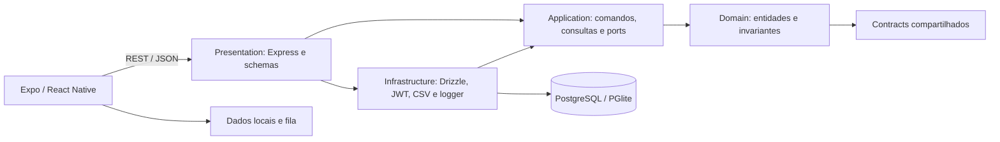

# QQS App

[](https://github.com/feralice/qqs-app/actions/workflows/ci.yml)

Aplicativo de visitas técnicas para a QQS, com cadastro de empresas e sistemas, agenda, check-in por localização e histórico administrativo. O técnico consulta dados salvos no aparelho e registra operações para sincronizar quando a conexão volta.

O projeto usa um monólito modular com Clean Architecture no backend. Casos de uso dependem de interfaces; Express, banco, CSV e segurança ficam nos adaptadores. Um teste verifica a direção dos imports.

## O que está implementado

- Login por e-mail e senha, cadastro de técnicos e refresh token com rotação.
- Empresas com CNPJ validado, coordenadas, raio de atendimento e sistemas.
- O técnico agenda, inicia e conclui visitas; fora do raio, o check-in exige justificativa.
- Supervisores consultam o painel e o histórico, exportam CSV e alteram agenda e responsável.
- Dados locais e fila de operações mantêm o trabalho disponível offline. A API usa o id da visita e `operationId` nas retentativas.

Checklists por tipo de sistema, assinatura, PDF e armazenamento de fotos em serviço de objetos ainda dependem dos requisitos pendentes. O serviço de notificações tem testes de caso de uso, mas não está conectado às rotas nem a provedores reais.

## Stack e organização

| Parte | Tecnologias |
| --- | --- |
| App mobile e web | React Native, Expo, Expo Router, TypeScript |
| API | Node.js, Express 5, Zod 4, Pino, Swagger UI |
| Banco | PostgreSQL, Drizzle ORM e PGlite no desenvolvimento |
| Dados no aparelho | Expo SQLite; localStorage na versão web |
| Qualidade | TypeScript strict, node:test, teste de arquitetura, GitHub Actions |



As setas entre camadas representam dependências de código. `backend/src/presentation/app.ts` compõe os adaptadores concretos.

```text
backend/src/
  domain/           entidades, invariantes e erros por categoria
  application/      commands, queries e ports por área de negócio
  infrastructure/   persistência, segurança, CSV, relógio e logging
  presentation/     HTTP, rotas, schemas e composição
  test-support/     helpers e repositórios em memória para testes
frontend/
  app/              navegação com Expo Router
  src/modules/      auth, clients, visits, admin, location e sync
packages/contracts/ tipos e validações compartilhados
docs/               requisitos, arquitetura, ADRs, specs e planos
```

## Rodar localmente

Use Node.js 22 e npm 10 ou superior. Na raiz:

```bash
npm ci
npm run dev:backend
```

Sem `DATABASE_URL`, o backend aplica as migrações e usa PGlite em `backend/.data/pglite`. As contas locais são `admin1@qqs.app` / `Admin123!` e `tecnico@qqs.app` / `Tecnico123!`. O seed não roda em produção.

Em outro terminal:

```bash
npm run dev:web
# Ou, para o dispositivo:
npm run dev:frontend
```

A API responde em `http://localhost:3333`. A documentação interativa está em [Swagger UI](http://localhost:3333/docs/) e o documento gerado em [OpenAPI](http://localhost:3333/openapi.json). Faça login, copie o `accessToken` e use **Authorize** no Swagger.

Para um aparelho na rede local, configure o endereço acessível da API:

```bash
EXPO_PUBLIC_API_URL=http://192.168.0.10:3333 npm run dev:frontend
```

Com PostgreSQL, defina `DATABASE_URL` e `JWT_SECRET`. Veja as instruções e variáveis em [ambiente local](docs/desenvolvimento/ambiente-local.md).

## Verificar o projeto

```bash
npm run typecheck:all
npm test
npm run db:check --workspace=@qqs/backend
npm run test:coverage --workspace=@qqs/backend
```

`typecheck:all` confere contracts, backend e frontend. `npm test` executa as suítes dos workspaces. Os testes de persistência usam PGlite em memória; não exigem um PostgreSQL externo. O script `lint` existente confere tipos e não executa ESLint.

O CI repete essas verificações em pushes e pull requests. O relatório textual de cobertura do backend fica no artefato `backend-coverage`. `drizzle-kit check` confere a consistência do histórico de migrações; mudanças no schema também exigem gerar e revisar a migração SQL.

## Decisões e contribuição

As decisões de arquitetura estão em [docs/adr](docs/adr/README.md), incluindo limites da idempotência e a fonte única de schemas HTTP/OpenAPI. O [documento de arquitetura](docs/arquitetura/ARQ-001-qqs-app.md) descreve os componentes e o que ainda está planejado.

Leia [CONTRIBUTING.md](CONTRIBUTING.md) para o fluxo de alterações. Para ferramentas de IA, [CLAUDE.md](CLAUDE.md) reúne as regras do projeto, também referenciadas por [AGENTS.md](AGENTS.md).
