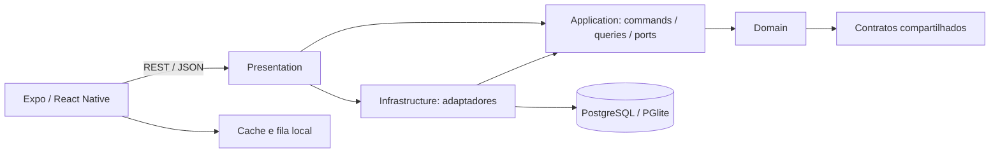

# Arquitetura de Software: QQS App

**Versão:** 0.2

**Status:** arquitetura implementada para autenticação, empresas, visitas e administração

## Visão geral

O QQS App usa um monólito modular com Clean Architecture no backend e React Native/Expo no frontend. A versão web compartilha os módulos de interface e usa adaptações de armazenamento. Casos de uso e contratos permitem testar regras sem depender de Express ou de um servidor de banco externo.



As setas de camadas representam dependências de código. A composição das implementações acontece em `backend/src/presentation/app.ts`.

## Estrutura do backend

```text
backend/src/
  domain/
    common/           actor e AppError por categoria
    auth/             usuário e erros de autenticação
    clients/          invariantes de empresa e sistemas
    visits/           entidade, visibilidade e regras de chegada
  application/
    common/           Clock, IdempotencyStore e TabularExporter
    admin/            comandos e consultas administrativas
    auth/             comandos de sessão e consulta de técnicos
    clients/          comandos de cadastro e consultas
    visits/           criação, início, conclusão e consultas visíveis
    notifications/    serviço ainda não conectado a provedores
  infrastructure/
    db/               Drizzle, schema e seed
    persistence/      implementações dos repositórios
    security/         JWT, bcrypt e rate limiter
    idempotency/      resultados persistidos de operações admin
    csv/              formato e proteção de células
    clock/            relógio do sistema
    logging/          Pino e redaction
  presentation/
    http/             ApiRouter, autenticação, erros e OpenAPI
    routes/           admin, auth, clients, health e visits
    app.ts            composition root
  test-support/       helpers HTTP e fakes em memória
  architecture.test.ts
  config.ts
  server.ts
```

`domain` depende apenas de si e dos contratos. `application` usa domínio, contratos e módulos nativos do Node. Adaptadores implementam ports da aplicação; apresentação compõe as camadas e traduz HTTP. `architecture.test.ts` confere imports estáticos. Ele não substitui revisão de imports dinâmicos nem de regras indevidamente colocadas em handlers.

Comandos e consultas são separados na aplicação e compartilham o banco. Não há event sourcing. `Clock` torna padrões de data testáveis, `TabularExporter` mantém CSV fora dos casos de uso e `IdempotencyStore` abstrai a persistência de resultados administrativos.

## Contrato HTTP

Rotas são registradas com `api.route`, com política `public`, `authenticated` ou `supervisor`. Guards rodam antes da validação de body e query. Schemas Zod definem o formato de entrada e a documentação das respostas, com compatibilidade conferida contra `@qqs/contracts` quando aplicável.

A geração com `z.toJSONSchema` produz OpenAPI 3.1 em `/openapi.json`; Swagger UI fica em `/docs/`. Schemas de saída não são uma validação automática do retorno. Presenters convertem entidades para contratos e omitem ids internos de operações.

Erros de domínio usam categorias e mensagens preservadas para compatibilidade. O handler central traduz categorias em status e retorna `{ error, details? }`. Falhas inesperadas são registradas e retornam mensagem genérica. Pino aplica redaction de senha e token; o cliente de autenticação não registra payloads sensíveis.

## Frontend e dados locais

`frontend/app` contém a navegação. Os módulos em `frontend/src/modules` separam autenticação, empresas, visitas, administração, localização e sincronização. Dados de visitas, empresas e fila usam Expo SQLite no aparelho e localStorage no navegador. A sessão usa Expo SecureStore no dispositivo.

O app permite trabalhar com dados já baixados e retoma a fila ao abrir a lista ou solicitar sincronização. Nem toda ação de administração é uma operação offline. Autenticação e novos downloads exigem conexão.

A interface usa a seguinte paleta:

| Uso | Cor |
| --- | --- |
| Cabeçalho e navegação | `#0876C9` |
| Superfícies suaves | `#B9DDF8` |
| Contato e detalhes | `#72BAB8` |
| Fundos e textos do cabeçalho | `#FFFFFF` |
| Áreas de contraste | `#242424` |
| Títulos e textos principais | `#383838` |

## Persistência e sincronização

PostgreSQL é o banco remoto e Drizzle é o adaptador. Sem `DATABASE_URL`, o backend usa PGlite persistido localmente; testes usam PGlite em memória. Migrações SQL em `backend/drizzle` são aplicadas ao abrir o banco. O seed não roda em produção.

O aparelho mantém ids estáveis para visitas e operações. A criação verifica o id da visita; início e conclusão guardam ids de operação. Ações admin persistem respostas em `processed_operations`. Alteração e registro de idempotência ainda não fazem parte de uma transação única, portanto não oferecem execução única para toda condição de falha ou concorrência. Veja [ADR 0005](../adr/0005-offline-fila-idempotencia.md).

O histórico usa o mesmo filtro em JSON e CSV. O CSV tem separador `;`, BOM UTF-8 e proteção contra células interpretadas como fórmulas.

## Segurança e verificação

A autenticação atual usa e-mail e senha, bcrypt e access token JWT com refresh token revogável e rotação. Autorização diferencia técnico e supervisor. O rate limiter de login é local ao processo. Com PostgreSQL, `JWT_SECRET` é obrigatório; contas conhecidas de desenvolvimento não são semeadas em produção.

GitHub Actions usa Node 22 e lockfile, executa typechecks dos três projetos, testes, cobertura de backend e `drizzle-kit check`. O check confere o histórico de migrações; geração e revisão continuam necessárias para acompanhar alterações no schema.

## Funcionalidades planejadas

Checklists por tipo de sistema aguardam RA-006 e assinatura aguarda RA-004. Geração de PDF e upload de fotos em armazenamento de objetos não estão implementados. O banco deverá guardar metadados e referências quando essa integração for definida.

O serviço de notificações possui testes isolados, mas não está ligado às rotas nem a push ou WhatsApp reais. A resolução de alertas ainda precisa de integração com a origem dos alertas do painel. Não apresentar esses recursos como entrega concluída.

Também ficam pendentes política de conflitos entre dispositivos, revisão de visitas sincronizadas, autenticação por telefone e provedor definitivo de armazenamento.

## Decisões registradas

Consulte [docs/adr](../adr/README.md) para decisões sobre monólito modular, categorias de erro, schemas HTTP/OpenAPI, banco local e idempotência.
